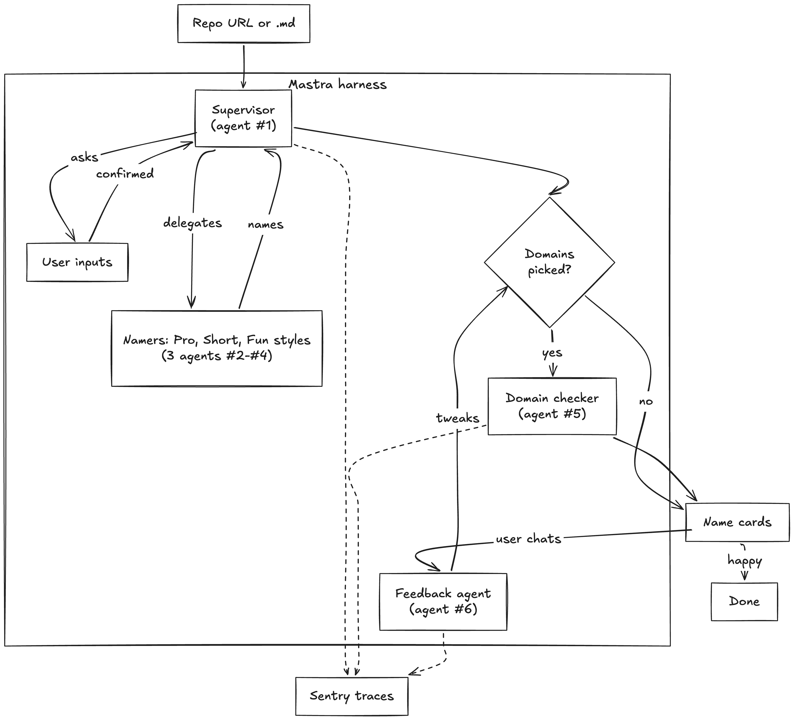

# namematch

Live: https://namematch.tech

Paste your project, get name ideas, and see which domains are free.

## What it does

You paste a GitHub repo link or a `.md` file and answer a few quick questions. A team of AI agents then suggests names for your project and checks if the domains are available (`.com`, `.dev`, `.app`, `.tech`, `.ai`). Then you chat with it to refine the names, as many rounds as you like.

This app is for developers who have built something and got stuck on what to call it. The vibe is playful and plain-spoken: a colorful, chunky UI, short answers, and a live log that shows what each agent is doing.

## How it works



Six agents, each with one job:

- **Supervisor:** reads your project, pre-fills the questions, plans which namers to use, and picks the best 5 names.
- **Professional namer:** credible, brandable names you can say in a meeting.
- **Short & cool namer:** 4 to 7 letter names that are invented or blended and easy to type.
- **Random & fun namer:** playful, absurd, wordplay names.
- **Domain checker:** for names with no free domain, suggests close variants (like a `get` prefix or `hq` suffix).
- **Feedback:** takes your chat messages and adjusts or adds names.

Workflows decide the steps and agents make the creative decisions. Agents never call each other, and domain lookups are plain code.

## What it's built with

- [Mastra](https://mastra.ai): agents and workflows.
- Gemma 4 open models: the models behind every agent, through Google's API or locally with Ollama.
- RDAP: open data for domain checks, no API key needed.
- Hono: the small server.
- React + Vite + Tailwind: the web UI.
- Sentry: tracing of agent and workflow runs (optional).

## Run it yourself

Shared setup: Node 24 or newer, pnpm, then:

```sh
git clone https://github.com/surrelsaga/namematch && cd namematch
cp .env.example .env
pnpm install
```

### Option 1: Gemma on Google's API (easiest)

- Get a free API key from Google AI Studio.
- In `.env`, set `GOOGLE_GENERATIVE_AI_API_KEY=your key`, `MODEL_ID=gemma-4-31b-it` and `FAST_MODEL_ID=gemma-4-26b-a4b-it`. Leave `MODEL_PROVIDER` empty.
- Run `pnpm dev` and open the Vite URL it prints.
- Note: your project description goes to Google's API, and the free tier is rate limited, so a run can take a few minutes.

### Option 2: Gemma on your own machine with Ollama (private)

- Install [Ollama](https://ollama.com) and pull Gemma 4: `ollama pull gemma4:26b`. The 26B is the realistic pick for most laptops (a 16 to 19 GB download). There is also `gemma4:31b` (about 20 GB), and smaller ones like `gemma4:e4b`. See all tags at [ollama.com/library/gemma4](https://ollama.com/library/gemma4).
- In `.env`, set `MODEL_PROVIDER=ollama`, and set `MODEL_ID` and `FAST_MODEL_ID` to your Ollama tag (the same tag for both is fine, for example `gemma4:26b`). No Google key needed. Set `OLLAMA_BASE_URL` only if Ollama isn't on `http://localhost:11434`.
- Run `pnpm dev`.
- What stays on your machine: the model runs locally, so your description never goes to Google. To keep it fully local, upload a `.md` instead of a GitHub link and leave `SENTRY_DSN` empty (Sentry traces include the prompts). Domain checks still send the candidate names, not your description, to the domain registries.
- Honest notes: this mode is untested. The "thinking off" setting in `src/mastra/agents/index.ts` is Google-only, so on Ollama every agent uses the model's default thinking and runs slower.

To poke at the agents and workflows on their own, run `pnpm mastra:dev` for Mastra Studio (port 4111).

What goes in `.env`:

| Variable | What it is |
|---|---|
| `GOOGLE_GENERATIVE_AI_API_KEY` | Your Google API key. Only for Option 1. |
| `MODEL_PROVIDER` | `google` (default) or `ollama`. |
| `MODEL_ID` | Model for the Supervisor and Feedback agents, for example `gemma-4-31b-it`. Required. |
| `FAST_MODEL_ID` | Model for the namers and Domain checker, for example `gemma-4-26b-a4b-it`. Required. |
| `OLLAMA_BASE_URL` | Only for Ollama. Defaults to `http://localhost:11434`. |
| `GITHUB_TOKEN` | Optional. Avoids GitHub's low rate limit when reading repos. |
| `SENTRY_DSN` | Optional. Leave empty to turn Sentry off. |
| `PORT` | Server port. Defaults to `3000`. |

## Make it yours

To add a namer in your own style (say, "old-timey" names), add a new feel. TypeScript will point out anything you miss.

1. `src/shared/types.ts`: add the feel to `Feel` and to `Actor`.
2. `src/shared/schemas.ts`: add it to `FeelSchema`.
3. `src/mastra/agents/index.ts`: create the agent with `make(...)`, using the same `NAMER_RULES` and 2 or 3 examples as the others, and add it to the `agents` object.
4. `src/mastra/workflows/common.ts`: add its label to `FEEL_LABEL`.
5. `src/mastra/workflows/generate-names.ts`: import the agent, add the feel to the list in `supervisorPick`'s `inputSchema`, and add `namer('your-feel', yourAgent)` to `.parallel([...])`.
6. `src/mastra/workflows/analyze-project.ts`: add the feel to the list in the prompt, so the Supervisor can suggest it.
7. `web/src/lib.ts`: add it to `FEELS` and `ACTORS` (pick a color class such as `bg-lilac`).

A run uses 1 or 2 feels, so your namer is picked next to the others, not instead of them.

## Good to know

- The free Google tier is slow and rate limited, so a run can take several minutes.
- The hosted demo sends your project description to Google's API.
- Sessions are kept in memory. A server restart or page reload starts over.
- Only public GitHub repos work. Domain results come from RDAP, so check with a registrar before you rely on one.

## License

MIT. See [LICENSE](LICENSE).
